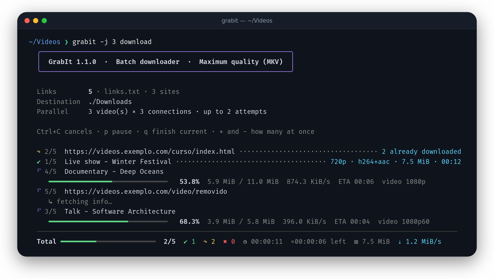
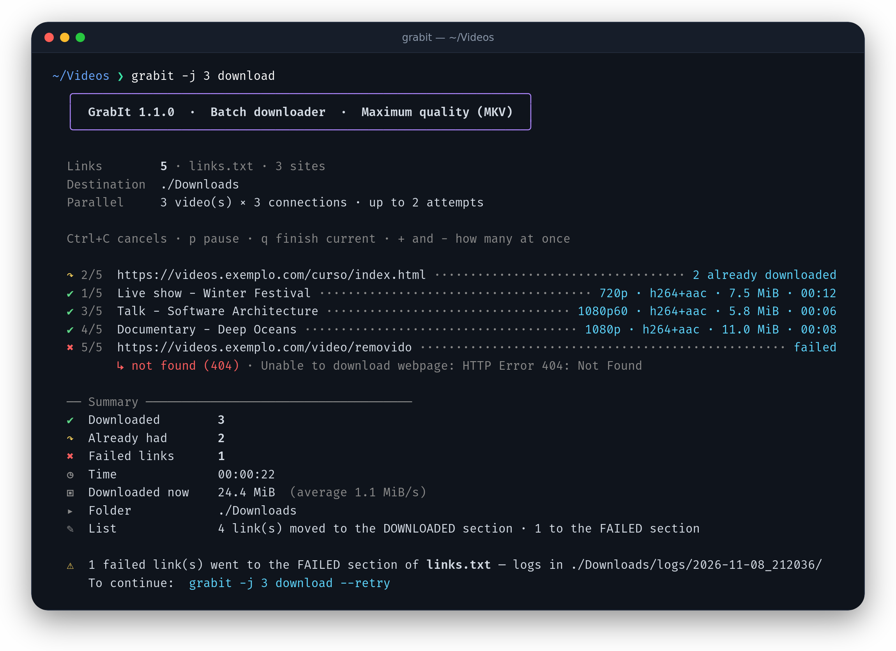

<p align="center">
  
</p>

<h1 align="center">GrabIt</h1>

<p align="center">
  <strong>Download videos from any site, in batches, always at maximum quality.</strong><br>
  A single Bash script on top of <a href="https://github.com/yt-dlp/yt-dlp">yt-dlp</a>, with a live panel in the terminal.
</p>

<p align="center">
  
  
  
  <a href="https://github.com/Canela-san/GrabIt/actions/workflows/testes.yml"></a>
  <a href="LICENSE"></a>
</p>

<p align="center">
  <a href="README.md">Português</a> · <strong>English</strong>
</p>

<p align="center">
  
</p>

## Why GrabIt?

- **Maximum quality, always.** It grabs the best video and the best audio available (4K, 60 fps, HDR, 5.1 sound — whatever exists) and puts them together in an MKV, without re-encoding anything. And it never hands you an incomplete video: if a piece is missing, the download fails and starts over from scratch.
- **Any site.** Works with everything yt-dlp supports: thousands of sites, playlists, channels and pages with embedded video.
- **Batch and parallel.** You hand it a list of links; it downloads several videos at once, each with several connections.
- **Live panel.** Progress, speed, time left and the quality of each download, an estimate of how long the whole batch still needs, without yt-dlp's flood of text. At the end, each video shows what was *actually* saved (read from the file with `ffprobe`).
- **Everything inside the file.** Subtitles, cover, chapters and metadata are embedded in the MKV.
- **Resilient.** Temporary failures get an automatic retry, and errors come explained in plain English (or Portuguese).
- **Never downloads twice.** Every downloaded video goes into a history; next time it's skipped right away, without touching the site or the file — even if you've already moved it to another folder.

## Installation

```bash
git clone https://github.com/Canela-san/GrabIt.git
cd GrabIt
bash grabit.sh --install
```

`--install` checks what's missing and shows the plan before doing anything: it installs FFmpeg and yt-dlp (with `curl-cffi`, to impersonate a browser when a site blocks automated downloads) through your system's package manager (apt, dnf, pacman, zypper, apk or Homebrew) and `pipx`, a JavaScript runtime if there's none that yt-dlp accepts (YouTube requires one to unlock the best resolutions), and creates the `grabit` command in `~/.local/bin`. A single confirmation, and nothing happens if you answer no.

To put everything on the newest version in one go:

```bash
grabit update
```

It updates GrabIt, yt-dlp with its dependencies, Deno and FFmpeg (the latter through your system's package manager, asking for the password only if there's a new version) and installs whatever is missing, without asking.

All commands work in English and Portuguese, with or without the dashes: `grabit update`, `grabit atualizar`, `grabit --update` and `grabit --atualizar` are the same thing. The same goes for `install`/`instalar`, `version`/`versao`, `check`/`verificar`, `downloaded`/`baixados` and `help`/`ajuda`. Only a link file named like a command needs `./` in front of it (`grabit ./update`).

To see the installed version, whether there's a newer one and what GrabIt is using (yt-dlp, FFmpeg, JavaScript runtime):

```bash
grabit --version
```

<details>
<summary>Manual installation</summary>

| Program | What for | How to install |
|---|---|---|
| [yt-dlp](https://github.com/yt-dlp/yt-dlp) | the download engine | `pipx install "yt-dlp[default,curl-cffi]"` |
| [FFmpeg](https://ffmpeg.org) | merging video and audio, building the MKV, handling covers | `sudo apt install ffmpeg` · `brew install ffmpeg` |
| [Deno](https://deno.com) *(recommended)* | required by YouTube to unlock the best resolutions | see the website |
| Bash 4.4+ | running the script | ships with Linux · on macOS: `brew install bash` |

And, to use the `grabit` command from any folder:

```bash
mkdir -p ~/.local/bin
ln -s "$PWD/grabit.sh" ~/.local/bin/grabit
```

</details>

## Usage

Create a `links.txt` with one link per line:

```text
# comments and empty lines are ignored
https://www.youtube.com/watch?v=XXXXXXXXXXX
https://vimeo.com/XXXXXXXXX          # you can add notes at the end of a line
https://www.youtube.com/playlist?list=XXXXXXXXXXXXXXXX
```

And run it in the same folder:

```bash
grabit
```

Successfully downloaded links **leave the list and move to the `DOWNLOADED` section**, at the end of the same `links.txt`, exactly as you wrote them (notes included), with the date and the title of what was downloaded at the end of the line. Everything in that section is ignored: it becomes your link history, and GrabIt doesn't waste time reprocessing or listing what's already done. The ones that failed stay at the top, ready for next time.

```text
# comments and empty lines are ignored
https://vimeo.com/XXXXXXXXX          # this one failed and stays here

# ==================== DOWNLOADED ====================
# Successfully downloaded links. GrabIt ignores everything until the end of this section.
https://www.youtube.com/watch?v=XXXXXXXXXXX  # ✔ 2026-10-24 · Video title
https://www.youtube.com/playlist?list=XXXXXXXXXXXXXXXX  # ✔ 2026-10-24 · 12 videos · Lesson 1 and others
# ================ END OF DOWNLOADED ================
```

Whatever comes after the `END OF DOWNLOADED` line counts as a link to download again, so appending to the end of the file works (`echo LINK >> links.txt`); next time, GrabIt moves those links up to the list at the top.

To work on the section without digging through the file:

```bash
grabit --downloaded               # list the section's links, numbered, with date and title
grabit --downloaded edit          # open just the section in your editor ($EDITOR, nano or vim)
grabit --downloaded back 3 5      # send links 3 and 5 back to the list to download
grabit --downloaded add LINK      # put a link in the section without downloading it
grabit --downloaded clear         # empty the section (asks first and keeps links.txt.bak)
```

In the editor, delete the lines you want out of the section, add links to mark them as downloaded and move below the last line the ones that should go back to the list. Use `-l FILE` for another link file. The video history doesn't change: to download again something already downloaded, run with `-i`.

> In Portuguese the section is called `BAIXADOS`; GrabIt recognizes both names, so switching languages doesn't mess up your list.
>
> You can edit the file while GrabIt runs: it's read again at the end, and whatever you added isn't lost. Want to download something from the section again? Move the line up and run with `-i` (see the history in [How it works](#how-it-works)).

More examples:

```bash
grabit https://youtu.be/XXXXXXXXXXX          # links straight on the command line
grabit https://youtu.be/XXXXXXXXXXX -x       # options work before or after the links
grabit -l courses.txt -o ~/Videos/Courses    # another list, another folder
grabit -j 4 -c 8                             # 4 videos at a time, 8 connections each
grabit -b firefox                            # use the browser's login (restricted videos)
grabit -x -l songs.txt -o ~/Music            # audio only, at the best quality
grabit -d                                    # sort into folders: Downloads/site/channel/
grabit -C                                    # copy links in the browser and they get downloaded
cat list.txt | grabit -l -                   # read links from standard input
```

### While downloading

| Key | What it does |
|---|---|
| <kbd>p</kbd> | pauses everything (running downloads freeze) and resumes |
| <kbd>q</kbd> | stops after the current downloads; the remaining ones go to `links_falhos.txt`. Again: cancels right away |
| <kbd>+</kbd> / <kbd>-</kbd> | raises or lowers how many videos download at once |
| <kbd>Ctrl</kbd>+<kbd>C</kbd> | cancels right away; anything half-done starts over from scratch next time |

### Options

| Option | What it does | Default |
|---|---|---|
| `-l FILE` | file with the links (`-` = standard input) | `links.txt` |
| `-o FOLDER` | folder where videos are saved | `./Downloads` |
| `-j N` | simultaneous downloads | `2` |
| `-c N` | connections (fragments) per video | `4` |
| `-r HEIGHT` | maximum resolution (`720`, `1080`, `2160` or `4k`…) | no limit |
| `-F` | force: ignore the `grabit.config` limits for this run | — |
| `-b BROWSER` | use the browser's cookies (`firefox`, `chrome`, `brave`…) | — |
| `-A AGENT` | use the browser's User-Agent, along with `-b`, on sites with a check | — |
| `-p` | if the link is a video inside a playlist, download just the video | — |
| `-x` | audio only: the best track, in its original format, no re-encoding | — |
| `-d` | sort into subfolders by site and channel: `Downloads/youtube.com/Channel/` | — |
| `-f` | live queue: after the list, stays open downloading whatever you add to the link file | — |
| `-U` | upgrade: check videos already downloaded and replace those that have a better version on the site today | — |
| `-C` | capture: while GrabIt is open, every link you copy joins the queue (and is written to `links.txt`) | — |
| `-m` | lay out for Jellyfin, Plex and Kodi: `Channel/Season 2026/`, with `.nfo` and cover alongside | — |
| `-u` | on pages with several videos (previews, related…), download only the main one: the longest | — |
| `-a` | include automatic subtitles (manual ones still take priority) | — |
| `-s` | mark sponsors and intros as chapters ([SponsorBlock](https://sponsor.ajay.app)) | — |
| `-i` | ignore the download history and check file by file | — |
| `-v` | full check: decode every video end to end looking for defects | — |
| `-L pt\|en` | language of the messages: Portuguese or English | the system's |
| `-h` | show the help (`grabit -L en -h` shows it in English) | — |

### Difficult sites

If the video plays in a browser, you can download it, even on sites with an anti-bot check (like Cloudflare's) or a JavaScript player, where yt-dlp alone can't find the video. You still just run `grabit LINK`:

```bash
grabit 'site.com/player?season=7&episode=1'
```

> If the link has `&` or `?`, put it in quotes (the terminal reads those symbols differently) or use `links.txt`.

**GrabIt opens Firefox by itself.** When a page only works in a browser, a Firefox window opens on it, GrabIt reads the video's request from the browser's own log, closes the window and downloads. If a check shows up, it's yours to do in the window: it's kept in a profile just for GrabIt (your regular Firefox doesn't change), so the next links tend to go straight through while it lasts. If the video doesn't start by itself, press play. With `USAR_NAVEGADOR=0`, the window never opens. For now this only works with Firefox; without it, you still have the two paths below.

**Use the browser's session.** Open the page, pass the check and run:

```bash
grabit -b firefox LINK
```

Sites with a check tend to accept the cookies only along with the User-Agent of the browser where you passed it (in Firefox, it's shown in `about:support`). Keep both in `grabit.config`, as `COOKIES_NAVEGADOR` and `USER_AGENT`, so you don't have to repeat them:

```bash
grabit -b firefox -A "Mozilla/5.0 (…)" LINK
```

**Copy the video's request.** It also works when yt-dlp doesn't recognize the page:

1. Open the page and press play.
2. Hit <kbd>F12</kbd>, go to the **Network** tab and filter by `m3u8` (or `mp4`). If there's more than one, choose the `master`: it points to both the video and the audio.
3. Right-click the request and choose **Copy as cURL**.
4. Run the command below, which reads the clipboard:

```bash
grabit curl
```

If you prefer, paste the copied command after `grabit` (GrabIt's options go before `curl`) or use `grabit curl FILE`:

```bash
grabit -o ~/Videos curl 'https://…/master.m3u8' -H 'Referer: https://…'
```

The copied command is only read, never executed. The file name comes from the page or, if the browser doesn't tell it, from the video's path. These links tend to expire: if it fails, copy it again. DRM-protected videos aren't downloaded.

## Configuration

Defaults live in **`grabit.config`**, next to `grabit.sh`. It's created on the first run, in your language, with every option commented out: to change one, remove the `#` at the start of the line and edit the value.

```ini
# grabit.config
IDIOMA=en
PASTA_SAIDA=~/Videos/GrabIt
DOWNLOADS_SIMULTANEOS=3
COOKIES_NAVEGADOR=firefox
```

| Key | What it does | Default |
|---|---|---|
| `IDIOMA` | language of the messages: `pt`, `en` or `auto` (follows the system) | `auto` |
| `ARQUIVO_LINKS` | list read when you run just `grabit` | `links.txt` |
| `PASTA_SAIDA` | where videos are saved | `./Downloads` |
| `RESOLUCAO_MAXIMA` | maximum resolution (`1080`, `2160`, `4k`…); `0` = no limit | `0` |
| `SO_AUDIO` | `1` downloads only the audio (same as `-x`) | `0` |
| `FORMATO_AUDIO` | `original` (no re-encoding) or `mp3`, `m4a`, `aac`, `opus`, `flac`, `wav`, `alac`, `vorbis` | `original` |
| `RESOLUCAO_ALERTA` | warn when the best version available is below this; `0` = never | `720` |
| `DOWNLOADS_SIMULTANEOS` | videos at the same time | `2` |
| `CONEXOES_POR_VIDEO` | connections per video | `4` |
| `TENTATIVAS` | attempts per link (`1` = don't retry) | `2` |
| `LIMITE_POR_SITE` | downloads at once from the same site (`0` = no limit) | `0` |
| `PAUSA_ENTRE_VIDEOS` | seconds of pause before each video, with random variation | `0` |
| `LIMITE_VELOCIDADE` | maximum speed per download, like `5M` or `500K` (`0` = no limit) | `0` |
| `IDIOMAS_LEGENDAS` | subtitle languages (`all` = every one) | `pt.*,en.*` |
| `LEGENDAS_AUTOMATICAS` | `1` includes automatic subtitles | `0` |
| `SPONSORBLOCK` | `1` marks sponsors and intros as chapters | `0` |
| `SEM_PLAYLIST` | `1` downloads just the video when the link also has a playlist | `0` |
| `VERIFICAR` | `1` runs the full check on every download (same as `-v`) | `0` |
| `SO_PRINCIPAL` | `1` downloads only the main video of pages with several videos (same as `-u`) | `0` |
| `COOKIES_NAVEGADOR` | browser whose login will be used | — |
| `USER_AGENT` | that browser's User-Agent (see [Difficult sites](#difficult-sites)) | — |
| `OPCOES_YTDLP` | extra options for yt-dlp, separated by spaces (e.g. `--force-ipv4`) | — |
| `USAR_NAVEGADOR` | `1` opens Firefox when a page only works in a browser; `0` never opens it | `1` |
| `USAR_HISTORICO` | `0` turns off the download history | `1` |
| `ARQUIVO_FALHAS` | where to save the links that failed | `links_falhos.txt` |
| `NOTIFICAR` | bell and desktop notification at the end of batches of 1 min or more (`0` = silence) | `1` |
| `NTFY_TOPICO` | [ntfy](https://ntfy.sh) topic (or your own server's URL) to notify your phone | — |

The keys keep their original (Portuguese) names in both languages, so the same `grabit.config` works whichever language you use.

Priority is: **`grabit.config` < environment variable < command-line option**. That way you can change something just once without editing the file:

```bash
DOWNLOADS_SIMULTANEOS=4 grabit    # only for this run
grabit -j 4                       # same, through the option
grabit --config                   # show the values in use and where each one came from
```

The file stays out of Git (`.gitignore`), so updating GrabIt never touches your settings. To go back to the defaults, just delete it: it's recreated.

### Maximum resolution

Want to save space? With `RESOLUCAO_MAXIMA=1080` GrabIt downloads the **best version up to 1080p** of each video — still picking the best codec, frame rate and audio within the limit. The limit applies to the shorter side of the picture, so a 1080×1920 vertical video counts as 1080p. If a video has no version within the limit, it isn't downloaded: it shows up as a failure, with a notice, and goes to `links_falhos.txt`.

For an exception, use `-F` (force): it ignores the `grabit.config` limits for that run only. And `-r` sets a limit for a single run, without touching the file.

```bash
grabit -r 720                       # just this time, up to 720p
grabit -F -l links_falhos.txt       # download the ones left out, at maximum quality
```

> Videos downloaded with a limit go into the history as usual. To replace them later with the best version, run `grabit -U -F`.

### Being nice to sites

Some sites block whoever downloads many videos in a row. For those, you can slow down:

```ini
LIMITE_POR_SITE=1        # one video at a time from each site (other sites keep going in parallel)
PAUSA_ENTRE_VIDEOS=10    # a ~10 to 15 s pause before each video
LIMITE_VELOCIDADE=5M     # at most 5 MB/s per download
```

The header shows the limits in use, and `-F` turns all of them (and the maximum resolution) off for a run.

There are also `ARQUIVO_HISTORICO` (where the download history lives) and `NO_COLOR` (turns colors off), as environment variables only.

## A summary at the end

<p align="center">
  
</p>

| Symbol | Meaning |
|---|---|
| ✔ | downloaded now |
| ↷ | had already been downloaded (by the history or because the file was already in the folder), skipped |
| ✖ | failed, with the reason explained right below |
| ⚠ | the video is complete, but some detail failed (e.g. converting the cover) |
| ▾ | downloaded, but the best version the site offered was below `RESOLUCAO_ALERTA` (sometimes, logged in with `-b`, there's more) |

Links that failed go to `links_falhos.txt`, and GrabIt itself shows the command to retry just those. The file accumulates: a run with other links doesn't erase earlier failures, and each link leaves it once it succeeds. If they all succeed, the file is deleted automatically.

## How it works

- **Format:** yt-dlp's `bv*+ba/b` (best video + best audio) with **MKV** output, which accepts any codec. Nothing is re-encoded.
- **Temporary files** live in `Downloads/.parciais` only while GrabIt runs; the final, finished file goes to the folder. A download that didn't finish (<kbd>Ctrl</kbd>+<kbd>C</kbd>, error, network drop) **starts over from scratch** next time instead of resuming the pieces: resuming can leave holes in the video, and here quality comes before speed. The links that were still pending go to `links_falhos.txt`.
- **Retries:** temporary errors (network, 403, 429) go back to the end of the queue and try another way: one connection at a time, with the `Referer`, impersonating a browser when `curl-cffi` is installed and with the adjustment for the error (IPv4 on network failures, slower on 429). Permanent errors (private, removed video, 404) aren't retried.
- **Disk full:** the header warns you when the destination folder has less than 2 GiB free. If the disk fills up midway, no new download starts (the next ones wouldn't fit either) and the links still pending go to `links_falhos.txt`.
- **History:** every downloaded video is recorded in `Downloads/.grabit-historico.txt` (site + video ID). Next time it's skipped before anything else: on most sites GrabIt doesn't even need to open the page. Without the history, yt-dlp would open the page again, download the cover and rewrite the whole file just to conclude it already exists. Videos downloaded before the history existed go through that check only once and are added to it.
- **Live queue (`-f`):** after finishing the list, GrabIt stays open and checks the link file every 2 seconds: whatever you add (at the top or at the end of the file) joins the queue and starts downloading. When the queue empties, the downloaded links go to the `DOWNLOADED` section and, if the batch took a while, the completion notice arrives. Quit with <kbd>q</kbd> or <kbd>Ctrl</kbd>+<kbd>C</kbd>. It only happens with the option: without `-f`, GrabIt always closes when done.
- **Checking the collection (`grabit --check [FOLDER]`):** decodes, from start to end, every video and audio file already in the downloads folder (or the folder given) and compares its duration with the one recorded in the `info.json` GrabIt embeds in MKVs — so it finds defective files and incomplete downloads, old ones included. At the end, it offers to download the problem ones again: the current file is kept with `.with-errors` in its name, the video leaves the history and the link (kept in that same `info.json`) is downloaded again, in the same folder layout (`-d` or `-m`).
- **Upgrade (`-U`):** for each link in the list — including the ones in the `DOWNLOADED` section —, compares the best version the site offers today with the file already in the folder (found by the `[id]` in its name). It only downloads again what got better: higher resolution, or the same one with more frames per second or HDR. The old file is only deleted after the new one arrives complete; if the download fails or is cancelled, it comes back. Videos you moved out of the folder are skipped. Handy after downloading with a resolution limit, or when a site starts offering 4K.
- **Clipboard capture (`-C`):** while GrabIt is open, every link you copy (<kbd>Ctrl</kbd>+<kbd>C</kbd> in the browser) is written to the end of `links.txt` and joins the queue — it works like the live queue. Whatever was already copied before it opened and text without links are ignored. Nothing keeps running in the background: once GrabIt closes, the capture is over. It uses `wl-paste` (Wayland), `xclip` or `xsel` (X11), `pbpaste` (macOS) or PowerShell (WSL).
- **Jellyfin, Plex and Kodi (`-m`):** each channel becomes a show, with one season per year and episodes named by date (`Channel/Season 2026/Channel - 2026-10-24 - Title [id].mkv`), a format all three recognize. Next to each video go the cover and an `.nfo` with title, date and description, and in the channel folder a `tvshow.nfo`. Point a *Shows* library at the downloads folder. It only happens with the option, and it takes priority over `-d`.
- **Audio only (`-x`):** downloads the best sound track and keeps it in the format the site delivers (opus, m4a…), without re-encoding, with cover, chapters and metadata. With `FORMATO_AUDIO=mp3` (or another one), it converts at the best quality. The audio history is separate (`.grabit-historico-audio.txt`): having downloaded the video doesn't stop you from downloading the audio, and vice versa.
- **Full check (`-v`):** after downloading, ffmpeg decodes the whole video, frame by frame, with the progress on the panel. Any defect fails the file: it doesn't go into the history, it's kept with `.with-errors` in its name and the video is downloaded again from scratch. If the defect comes from the site itself and happens again, the link goes to `links_falhos.txt`. It guarantees a flawless file, at the cost of CPU and time.
- **Main video (`-u`):** when a page has several videos, GrabIt first checks each one's duration (from the site or, if it doesn't say, by reading just the video's header) and downloads only the longest — previews and related videos tend to be short. Links with a single video skip this step. Don't use it with playlists and channels: they'd also yield a single video.
- **Logs:** yt-dlp's full output for every link with a problem is kept in `Downloads/logs/<date>/`.
- **Terminal:** the panel adapts to the window width (even if you resize it midway), aligns titles with emoji and Asian characters and, if the output is redirected to a file, swaps the panel for plain lines without colors.

## Tips

- **Keep yt-dlp up to date** (`grabit --update`): sites change all the time. GrabIt warns you when the installed version is old.
- **Warning about the JavaScript runtime?** yt-dlp only accepts recent versions: an old Node.js is refused, and Bun can be too new. `grabit --version` shows what's in use, and the safest one is Deno, which `grabit --install` installs when no other is accepted.
- **Video asks for a login or age confirmation?** Use `-b firefox` (or the browser you're logged in with).
- **Left it downloading and walked away?** With `NTFY_TOPICO=a-hard-name` in `grabit.config` and the [ntfy](https://ntfy.sh) app subscribed to the same topic, your phone tells you when the batch is done. Only the summary goes out (how many downloaded and how many failed), never links or titles.
- **Retry what failed:** `grabit -l links_falhos.txt`.
- **Deleted a video and want it again?** Run with `-i` (ignores the history) or delete its line in `Downloads/.grabit-historico.txt`.

## Tests

```bash
bash testes/rodar.sh            # all of them: starts a local server and downloads videos made by ffmpeg
bash testes/rodar.sh --rapido   # downloads nothing: options, configuration, translations and the flow with a fake yt-dlp
```

Nothing leaves your machine: the test videos are created on the spot and served on `127.0.0.1`. On every push, GitHub Actions runs the full tests on Ubuntu, the quick ones on Bash 4.4, 5.0, 5.1 and 5.2 and on macOS, plus ShellCheck.

## Disclaimer

GrabIt is just a tool. Only download content you have the right to download, and respect each site's terms of use and your country's copyright law.

## Credits

Built on [yt-dlp](https://github.com/yt-dlp/yt-dlp) and [FFmpeg](https://ffmpeg.org), which do the heavy lifting.

## License

Distributed under the [MIT license](LICENSE). You can use, copy, modify and redistribute GrabIt freely, including in commercial projects. The only condition is keeping the copyright notice, with credit to **Gabriel Canela ([Canela-san](https://github.com/Canela-san))**, in all copies or substantial portions of the code.

If GrabIt helped you, a link to this repository is always welcome too.
