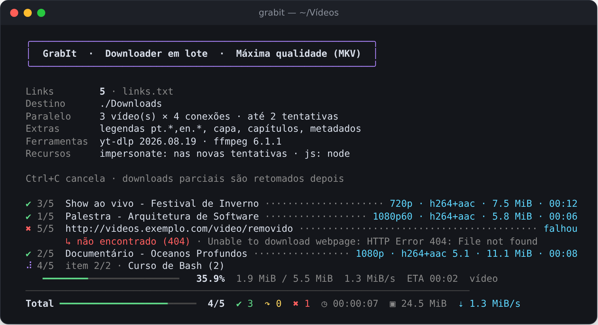
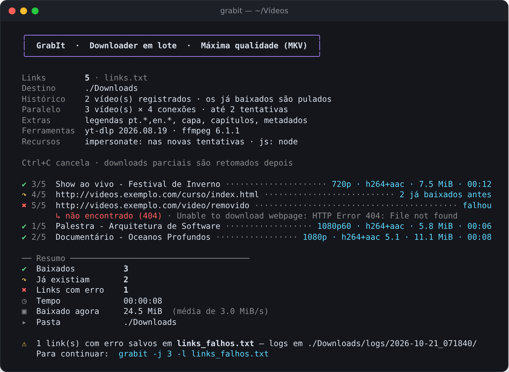

<p align="center">
  
</p>

<h1 align="center">GrabIt</h1>

<p align="center">
  <strong>Baixe vídeos de qualquer site, em lote, sempre na qualidade máxima.</strong><br>
  Um único script Bash sobre o <a href="https://github.com/yt-dlp/yt-dlp">yt-dlp</a>, com painel ao vivo no terminal.
</p>

<p align="center">
  
  
  
  <a href="LICENSE"></a>
</p>

<p align="center">
  <strong>Português</strong> · <a href="README.en.md">English</a>
</p>

<p align="center">
  
</p>

## Por que o GrabIt?

- **Qualidade máxima, sempre.** Pega o melhor vídeo e o melhor áudio disponíveis (4K, 60 fps, HDR, som 5.1 — o que existir) e junta tudo num MKV, sem recomprimir nada. E nunca entrega um vídeo incompleto: se faltar um pedaço, o download falha e recomeça do zero.
- **Qualquer site.** Funciona com tudo o que o yt-dlp suporta: milhares de sites, playlists, canais e páginas com vídeo embutido.
- **Em lote e em paralelo.** Você entrega uma lista de links; ele baixa vários vídeos ao mesmo tempo, cada um com várias conexões.
- **Painel ao vivo.** Progresso, velocidade, tempo restante e a qualidade de cada download, uma estimativa de quanto falta para o lote inteiro, sem a enxurrada de texto do yt-dlp. No fim, cada vídeo mostra o que *realmente* foi gravado (lido do arquivo com `ffprobe`).
- **Tudo dentro do arquivo.** Legendas, capa, capítulos e metadados vão embutidos no MKV.
- **Resiliente.** Falhas passageiras ganham nova tentativa automática e os erros vêm explicados em português (ou em inglês, se preferir).
- **Não baixa duas vezes.** Cada vídeo baixado entra num histórico; na próxima vez ele é pulado na hora, sem acessar o site nem mexer no arquivo — mesmo que você já o tenha movido para outra pasta.

## Instalação

### 1. Dependências

| Programa | Para quê | Como instalar |
|---|---|---|
| [yt-dlp](https://github.com/yt-dlp/yt-dlp) | o motor dos downloads | `pipx install "yt-dlp[default,curl-cffi]"` |
| [FFmpeg](https://ffmpeg.org) | juntar vídeo e áudio, gerar o MKV, tratar capas | `sudo apt install ffmpeg` · `brew install ffmpeg` |
| [Deno](https://deno.com) *(recomendado)* | exigido pelo YouTube para liberar as melhores resoluções | veja o site |
| Bash 4.4+ | rodar o script | já vem no Linux · no macOS: `brew install bash` |

> O `curl-cffi` permite imitar um navegador quando um site bloqueia downloads automáticos. É opcional, mas recomendado.

### 2. GrabIt

```bash
git clone https://github.com/Canela-san/GrabIt.git
cd GrabIt
chmod +x grabit.sh
```

Para usar o comando `grabit` em qualquer pasta (e atualizar com um simples `git pull`):

```bash
mkdir -p ~/.local/bin
ln -s "$PWD/grabit.sh" ~/.local/bin/grabit
```

## Uso

Crie um `links.txt` com um link por linha:

```text
# comentários e linhas vazias são ignorados
https://www.youtube.com/watch?v=XXXXXXXXXXX
https://vimeo.com/XXXXXXXXX          # dá para anotar no fim da linha
https://www.youtube.com/playlist?list=XXXXXXXXXXXXXXXX
```

E rode na mesma pasta:

```bash
grabit
```

Os links baixados com sucesso **saem da lista e vão para a seção `BAIXADOS`**, no fim do próprio `links.txt`, exatamente como você os escreveu (anotações incluídas), com a data e o título do que foi baixado no fim da linha. Tudo o que está nessa seção é ignorado: ela vira o seu histórico de links, e o GrabIt não perde tempo reprocessando nem listando o que já foi baixado. Os que falharam continuam em cima, prontos para a próxima vez.

```text
# comentários e linhas vazias são ignorados
https://vimeo.com/XXXXXXXXX          # este falhou e continua aqui

# ==================== BAIXADOS ====================
# Links já baixados com sucesso. O GrabIt ignora tudo até o fim desta seção.
https://www.youtube.com/watch?v=XXXXXXXXXXX  # ✔ 2026-10-24 · Título do vídeo
https://www.youtube.com/playlist?list=XXXXXXXXXXXXXXXX  # ✔ 2026-10-24 · 12 vídeos · Aula 1 e outros
# ================ FIM DOS BAIXADOS ================
```

O que vier depois da linha `FIM DOS BAIXADOS` volta a contar como link a baixar, então acrescentar no fim do arquivo funciona (`echo LINK >> links.txt`); na próxima vez, o GrabIt sobe esses links para a lista de cima.

> Em inglês, a seção se chama `DOWNLOADED`; o GrabIt reconhece os dois nomes, então trocar de idioma não bagunça a lista.
>
> Pode editar o arquivo enquanto o GrabIt roda: ele é relido no fim, e o que você acrescentou não se perde. Quer baixar de novo algo da seção? Mova a linha para cima e rode com `-i` (veja o histórico em [Como funciona](#como-funciona)).

Mais exemplos:

```bash
grabit https://youtu.be/XXXXXXXXXXX          # links direto no comando
grabit -l cursos.txt -o ~/Vídeos/Cursos      # outra lista, outra pasta
grabit -j 4 -c 8                             # 4 vídeos por vez, 8 conexões cada
grabit -b firefox                            # usa o login do navegador (vídeos restritos)
grabit -x -l musicas.txt -o ~/Música         # só o áudio, na melhor qualidade
grabit -d                                    # separa em pastas: Downloads/site/canal/
grabit -C                                    # copie links no navegador e eles vão sendo baixados
cat lista.txt | grabit -l -                  # lê os links da entrada padrão
```

### Durante o download

| Tecla | O que faz |
|---|---|
| <kbd>p</kbd> | pausa tudo (os downloads em andamento congelam) e continua |
| <kbd>q</kbd> | termina depois dos downloads atuais; os que faltavam vão para `links_falhos.txt`. De novo: cancela na hora |
| <kbd>+</kbd> / <kbd>-</kbd> | aumenta ou diminui quantos vídeos baixam ao mesmo tempo |
| <kbd>Ctrl</kbd>+<kbd>C</kbd> | cancela na hora; o que estava pela metade recomeça do zero na próxima vez |

### Opções

| Opção | O que faz | Padrão |
|---|---|---|
| `-l ARQUIVO` | arquivo com os links (`-` = entrada padrão) | `links.txt` |
| `-o PASTA` | pasta onde os vídeos são salvos | `./Downloads` |
| `-j N` | downloads simultâneos | `2` |
| `-c N` | conexões (fragmentos) por vídeo | `4` |
| `-r ALTURA` | resolução máxima (`720`, `1080`, `2160` ou `4k`…) | sem limite |
| `-F` | força: ignora os limites do `grabit.config` nesta execução | — |
| `-b NAVEGADOR` | usa os cookies do navegador (`firefox`, `chrome`, `brave`…) | — |
| `-p` | se o link for de um vídeo dentro de uma playlist, baixa só o vídeo | — |
| `-x` | só o áudio: a melhor faixa, no formato original, sem recomprimir | — |
| `-d` | organiza em subpastas por site e canal: `Downloads/youtube.com/Canal/` | — |
| `-f` | fila viva: depois da lista, continua aberto baixando o que você acrescentar ao arquivo de links | — |
| `-C` | captura: com o GrabIt aberto, todo link que você copiar entra na fila (e é anotado no `links.txt`) | — |
| `-m` | organiza para Jellyfin, Plex e Kodi: `Canal/Season 2026/`, com `.nfo` e capa ao lado | — |
| `-u` | em páginas com vários vídeos (prévias, relacionados…), baixa só o principal: o mais longo | — |
| `-a` | inclui legendas automáticas (as manuais continuam tendo prioridade) | — |
| `-s` | marca patrocínios e intros como capítulos ([SponsorBlock](https://sponsor.ajay.app)) | — |
| `-i` | ignora o histórico de baixados e confere arquivo por arquivo | — |
| `-v` | verificação completa: decodifica cada vídeo inteiro atrás de defeitos | — |
| `-L pt\|en` | idioma das mensagens: português ou inglês | o do sistema |
| `-h` | mostra a ajuda (`grabit -L en -h` mostra em inglês) | — |

## Configuração

Os padrões ficam no **`grabit.config`**, ao lado do `grabit.sh`. Ele é criado na primeira execução com todas as opções comentadas: para mudar uma, tire o `#` do começo da linha e edite o valor.

```ini
# grabit.config
PASTA_SAIDA=~/Vídeos/GrabIt
DOWNLOADS_SIMULTANEOS=3
COOKIES_NAVEGADOR=firefox
```

| Chave | O que faz | Padrão |
|---|---|---|
| `IDIOMA` | idioma das mensagens: `pt`, `en` ou `auto` (segue o sistema) | `auto` |
| `ARQUIVO_LINKS` | lista lida quando você roda só `grabit` | `links.txt` |
| `PASTA_SAIDA` | onde os vídeos são salvos | `./Downloads` |
| `RESOLUCAO_MAXIMA` | resolução máxima (`1080`, `2160`, `4k`…); `0` = sem limite | `0` |
| `SO_AUDIO` | `1` baixa só o áudio (o mesmo que `-x`) | `0` |
| `FORMATO_AUDIO` | `original` (sem recomprimir) ou `mp3`, `m4a`, `aac`, `opus`, `flac`, `wav`, `alac`, `vorbis` | `original` |
| `RESOLUCAO_ALERTA` | avisa quando a melhor versão disponível fica abaixo disso; `0` = nunca | `720` |
| `DOWNLOADS_SIMULTANEOS` | vídeos ao mesmo tempo | `2` |
| `CONEXOES_POR_VIDEO` | conexões por vídeo | `4` |
| `TENTATIVAS` | tentativas por link (`1` = sem repetir) | `2` |
| `LIMITE_POR_SITE` | downloads ao mesmo tempo do mesmo site (`0` = sem limite) | `0` |
| `PAUSA_ENTRE_VIDEOS` | segundos de pausa antes de cada vídeo, com variação aleatória | `0` |
| `LIMITE_VELOCIDADE` | velocidade máxima por download, como `5M` ou `500K` (`0` = sem limite) | `0` |
| `IDIOMAS_LEGENDAS` | idiomas das legendas (`all` = todas) | `pt.*,en.*` |
| `LEGENDAS_AUTOMATICAS` | `1` inclui legendas automáticas | `0` |
| `SPONSORBLOCK` | `1` marca patrocínios e intros como capítulos | `0` |
| `SEM_PLAYLIST` | `1` baixa só o vídeo quando o link também tem playlist | `0` |
| `VERIFICAR` | `1` faz a verificação completa em todo download (o mesmo que `-v`) | `0` |
| `SO_PRINCIPAL` | `1` baixa só o vídeo principal de páginas com vários vídeos (o mesmo que `-u`) | `0` |
| `COOKIES_NAVEGADOR` | navegador cujo login será usado | — |
| `USAR_HISTORICO` | `0` desliga o histórico de baixados | `1` |
| `ARQUIVO_FALHAS` | onde salvar os links que falharam | `links_falhos.txt` |
| `NOTIFICAR` | sino e notificação na área de trabalho no fim de lotes de 1 min ou mais (`0` = silêncio) | `1` |
| `NTFY_TOPICO` | tópico do [ntfy](https://ntfy.sh) (ou URL de um servidor seu) para avisar no celular | — |

A prioridade é: **`grabit.config` < variável de ambiente < opção do comando**. Assim dá para mudar algo só uma vez sem editar o arquivo:

```bash
DOWNLOADS_SIMULTANEOS=4 grabit    # vale só nesta execução
grabit -j 4                       # idem, pela opção
grabit --config                   # mostra os valores em uso e de onde veio cada um
```

O arquivo fica fora do Git (`.gitignore`), então atualizar o GrabIt nunca mexe nas suas configurações. Para voltar aos padrões, basta apagá-lo: ele é recriado.

### Resolução máxima

Quer economizar espaço? Com `RESOLUCAO_MAXIMA=1080` o GrabIt baixa a **melhor versão até 1080p** de cada vídeo — continua escolhendo o melhor codec, fps e áudio dentro do limite. O limite vale para o lado menor da imagem, então um vídeo vertical de 1080×1920 conta como 1080p. Se um vídeo não tiver nenhuma versão dentro do limite, ele não é baixado: aparece como falha, com o aviso, e vai para o `links_falhos.txt`.

Para uma exceção, use `-F` (forçar): ele ignora os limites do `grabit.config` só naquela execução. Já o `-r` define um limite só para a execução, sem mexer no arquivo.

```bash
grabit -r 720                       # só desta vez, até 720p
grabit -F -l links_falhos.txt       # baixa os que ficaram de fora, na qualidade máxima
```

> Vídeos baixados com limite entram no histórico normalmente. Para trocar um deles por uma versão maior depois, apague o arquivo e rode com `-F -i`.

### Cortesia com os sites

Alguns sites bloqueiam quem baixa muitos vídeos em sequência. Para esses, dá para ir mais devagar:

```ini
LIMITE_POR_SITE=1        # um vídeo por vez de cada site (os de outros sites seguem em paralelo)
PAUSA_ENTRE_VIDEOS=10    # ~10 a 15 s de pausa antes de cada vídeo
LIMITE_VELOCIDADE=5M     # no máximo 5 MB/s por download
```

O cabeçalho mostra os limites em uso, e `-F` desliga todos eles (e a resolução máxima) numa execução.

Também existem `ARQUIVO_HISTORICO` (onde fica o histórico de baixados) e `NO_COLOR` (desliga as cores), só como variáveis de ambiente.

## No fim, um resumo

<p align="center">
  
</p>

| Símbolo | Significado |
|---|---|
| ✔ | baixado agora |
| ↷ | já tinha sido baixado (pelo histórico ou porque o arquivo já estava na pasta), foi pulado |
| ✖ | falhou, com o motivo explicado logo abaixo |
| ⚠ | o vídeo está completo, mas algum detalhe falhou (ex.: converter a capa) |
| ▾ | baixado, mas a melhor versão que o site oferecia estava abaixo de `RESOLUCAO_ALERTA` (às vezes, com login, `-b`, há mais) |

Os links que falharam vão para `links_falhos.txt`, e o próprio GrabIt mostra o comando para tentar só eles de novo. Se todos derem certo na nova rodada, o arquivo é apagado sozinho.

## Como funciona

- **Formato:** `bv*+ba/b` do yt-dlp (melhor vídeo + melhor áudio) com saída em **MKV**, que aceita qualquer codec. Nada é recodificado.
- **Arquivos temporários** ficam em `Downloads/.parciais` só enquanto o GrabIt roda; o arquivo final, pronto, vai para a pasta. Um download que não terminou (<kbd>Ctrl</kbd>+<kbd>C</kbd>, erro, queda de rede) **recomeça do zero** na próxima vez, em vez de retomar os pedaços: a retomada pode deixar buracos no vídeo, e aqui a qualidade vem antes da velocidade. Os links que ainda faltavam vão para `links_falhos.txt`.
- **Novas tentativas:** erros passageiros (rede, 403, 429) voltam para o fim da fila, imitando um navegador quando o `curl-cffi` está instalado. Erros permanentes (vídeo privado, removido, 404) não são repetidos.
- **Histórico:** cada vídeo baixado é registrado em `Downloads/.grabit-historico.txt` (site + ID do vídeo). Nas próximas vezes ele é pulado antes de tudo: na maioria dos sites o GrabIt nem precisa abrir a página. Sem o histórico, o yt-dlp abriria a página de novo, baixaria a capa e reescreveria o arquivo inteiro só para concluir que ele já existe. Vídeos baixados antes do histórico existir passam por essa conferência uma única vez e já entram nele.
- **Fila viva (`-f`):** depois de terminar a lista, o GrabIt continua aberto e confere o arquivo de links a cada 2 segundos: o que você acrescentar (em cima ou no fim do arquivo) entra na fila e começa a baixar. Quando a fila esvazia, os baixados vão para a seção `BAIXADOS` e, se o lote demorou, chega o aviso de término. Sai com <kbd>q</kbd> ou <kbd>Ctrl</kbd>+<kbd>C</kbd>. Só acontece com a opção: sem `-f`, o GrabIt sempre fecha ao terminar.
- **Captura da área de transferência (`-C`):** com o GrabIt aberto, cada link que você copiar (<kbd>Ctrl</kbd>+<kbd>C</kbd> no navegador) é anotado no fim do `links.txt` e entra na fila — funciona como a fila viva. O que já estava copiado antes de abrir e textos sem link são ignorados. Nada fica rodando em segundo plano: fechou o GrabIt, acabou a captura. Usa `wl-paste` (Wayland), `xclip` ou `xsel` (X11), `pbpaste` (macOS) ou o PowerShell (WSL).
- **Jellyfin, Plex e Kodi (`-m`):** cada canal vira uma série, com uma temporada por ano e episódios nomeados pela data (`Canal/Season 2026/Canal - 2026-10-24 - Título [id].mkv`), formato que os três reconhecem. Ao lado de cada vídeo ficam a capa e um `.nfo` com título, data e descrição, e na pasta do canal um `tvshow.nfo`. Aponte uma biblioteca do tipo *Séries* para a pasta de downloads. Só acontece com a opção, e ela tem prioridade sobre `-d`.
- **Só áudio (`-x`):** baixa a melhor faixa de som e a guarda no formato em que o site entrega (opus, m4a…), sem recomprimir, com capa, capítulos e metadados. Com `FORMATO_AUDIO=mp3` (ou outro), converte na melhor qualidade. O histórico de áudio é separado (`.grabit-historico-audio.txt`): ter baixado o vídeo não impede de baixar o áudio, e vice-versa.
- **Verificação completa (`-v`):** depois de baixar, o ffmpeg decodifica o vídeo inteiro, quadro a quadro, com o progresso no painel. Qualquer defeito reprova o arquivo: ele não entra no histórico, fica guardado com `.com-erros` no nome e o vídeo é baixado de novo do zero. Se o defeito vier do próprio site e se repetir, o link vai para `links_falhos.txt`. Garante o arquivo perfeito, ao custo de CPU e tempo.
- **Vídeo principal (`-u`):** quando uma página tem vários vídeos, o GrabIt consulta antes a duração de cada um (pelo site ou, se ele não informar, lendo só o cabeçalho do vídeo) e baixa só o mais longo — prévias e relacionados costumam ser curtos. Links com um único vídeo não passam por essa etapa. Não use com playlists e canais: deles também sairia um vídeo só.
- **Logs:** a saída completa do yt-dlp para cada link com problema fica em `Downloads/logs/<data>/`.
- **Terminal:** o painel se adapta à largura da janela (inclusive se você redimensionar no meio), alinha títulos com emoji e caracteres asiáticos e, se a saída for redirecionada para um arquivo, troca o painel por linhas simples, sem cores.

## Dicas

- **Mantenha o yt-dlp atualizado** (`yt-dlp -U` ou `pipx upgrade yt-dlp`): os sites mudam o tempo todo. O GrabIt avisa quando a versão instalada está velha.
- **Vídeo pede login ou confirmação de idade?** Use `-b firefox` (ou o navegador em que você está logado).
- **Deixou baixando e saiu?** Com `NTFY_TOPICO=um-nome-dificil` no `grabit.config` e o app do [ntfy](https://ntfy.sh) assinando o mesmo tópico, o celular avisa quando o lote acabar. Só vai o resumo (quantos baixaram e quantos falharam), nunca os links ou os títulos.
- **Retomar o que falhou:** `grabit -l links_falhos.txt`.
- **Apagou um vídeo e quer baixá-lo de novo?** Rode com `-i` (ignora o histórico) ou apague a linha dele em `Downloads/.grabit-historico.txt`.

## Aviso

O GrabIt é só uma ferramenta. Baixe apenas conteúdo que você tem direito de baixar e respeite os termos de uso de cada site e a lei de direitos autorais do seu país.

## Créditos

Feito sobre o [yt-dlp](https://github.com/yt-dlp/yt-dlp) e o [FFmpeg](https://ffmpeg.org), que fazem o trabalho pesado.

## Licença

Distribuído sob a [licença MIT](LICENSE). Você pode usar, copiar, modificar e redistribuir o GrabIt à vontade, inclusive em projetos comerciais. A única condição é manter o aviso de copyright, com o crédito a **Gabriel Canela ([Canela-san](https://github.com/Canela-san))**, em todas as cópias ou partes substanciais do código.

Se o GrabIt te ajudou, um link para este repositório também é sempre bem-vindo.
